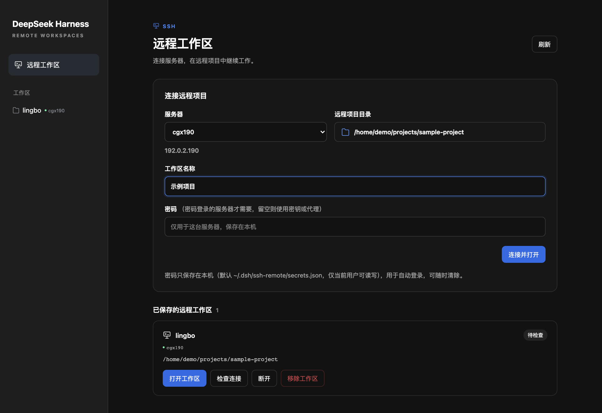
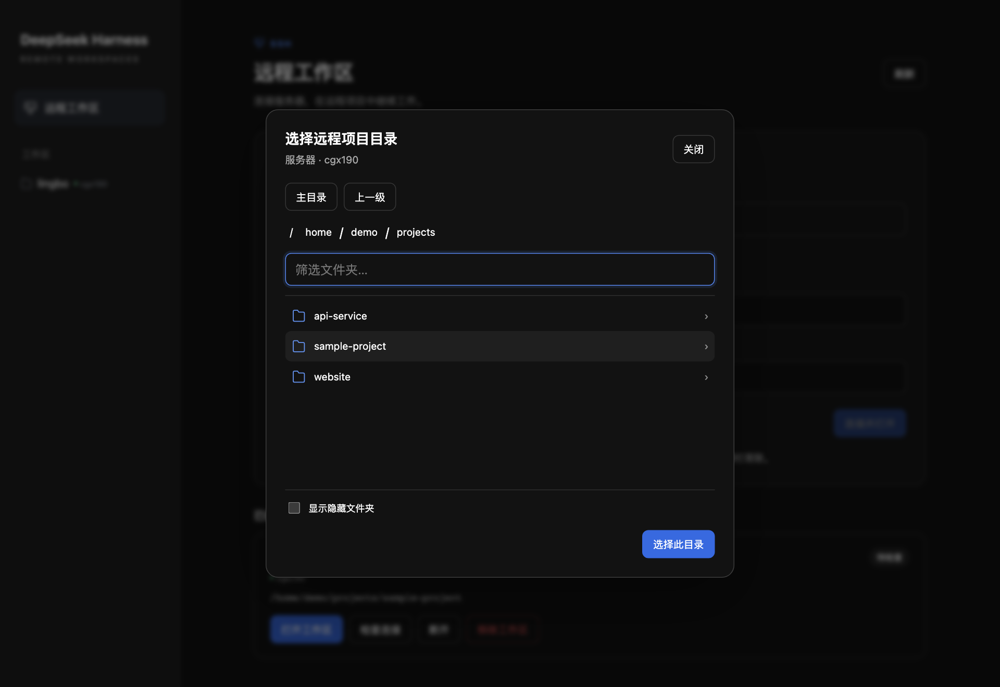

# DeepSeek Harness · Remote SSH

在 DeepSeek Harness 桌面侧边栏中连接 SSH 服务器，**浏览并选择远程目录**，直接打开远程工作区。



## 远程分区与侧栏分离

左侧栏中，「远程工作区」是与「工作区」并列的独立分区，按 **服务器 → 工作区 → 对话** 三层组织，直接用工作区名作为目录节点：

- **服务器**：显示连接状态，点按展开或收起。
- **工作区**：一个远程目录对应一个工作区，行上显示工作区名称（鼠标悬停可看完整远程路径）。名称在连接时填写，留空则取远程目录名；右键或「⋯」菜单可重命名工作区或新建对话，右侧的「＋」直接新建对话。
- **对话**列出该工作区的会话（已归档的、以及还没发过消息的「新对话」草稿不显示），点击即可打开。
- 会话支持右键或「⋯」菜单：置顶、重命名、分叉、归档、复制 Session ID。展开或收起目录时会保留原来的滚动位置。
- 远程工作区不会出现在原生「工作区」列表里，本地的工作区保持原样；新建会话时的工作区选择器中仍可选择远程工作区。隐藏只使用 CSS 规则，不修改原生侧栏的节点；若应用更新导致结构变化，远程分组会重新显示，不影响侧栏使用。

点击分区标题右侧的「管理」可打开完整管理页：连接服务器、选择目录、检查连接、修改密码、断开或移除工作区。管理页只展示工作区卡片，不列出对话。

## 目录选择

选择服务器 → 点击「选择服务器上的文件夹…」→ 打开目标文件夹 →「选择此目录」→「连接并打开」。

连接时可填写「工作区名称」，留空默认使用远程目录名。绿点标识远程工作区。



## 环境要求

本地支持 macOS 和 Linux，需要系统 OpenSSH。远端需要 POSIX `sh`、GNU/BSD `stat`、`readlink`、`mktemp` 等常见命令；执行远程终端命令还需要 `bash`。目前不支持 Windows/Pwsh。

先在终端确认可以登录服务器（需要密码的服务器也可以，见下文「密码认证」）。示例 `~/.ssh/config`：

```sshconfig
Host dev-server
  HostName dev.example.com
  User demo
  IdentityFile ~/.ssh/id_ed25519
```

```sh
ssh dev-server
```

上面的服务器地址是示例，请替换为自己的配置。

## 密码认证

需要密码的服务器可以直接连接：在面板的「密码」里填一次，密码保存在本机，之后自动登录，不必每次输入。选择远程目录时也会带上这个密码；如果还没填，目录选择器里会内联提示输入一次，保存后重试即可。

- 密码保存在 `~/.dsh/ssh-remote/secrets.json`（0600，仅当前用户可读写），可用配置项 `secretsFile` 改路径；在面板中点「清除密码」即可删除。
- 认证走 OpenSSH 自己的 `SSH_ASKPASS` 机制：密码不会出现在命令行参数里，`ssh` 仍然自己完成认证。密码只在建立连接时用到，之后所有操作复用同一条多路复用连接，连接过期后也会用保存的密码自动重建。
- 需要 OpenSSH ≥ 8.4（依赖 `SSH_ASKPASS_REQUIRE=force`，否则从终端启动 Harness 时 `ssh` 会去读 `/dev/tty`）。
- 只有当服务器提供 `password` 或 `keyboard-interactive` 认证时才会要求密码；纯密钥服务器仍按原来的方式处理。
- 不支持需要多轮交互的二次验证（例如两次 keyboard-interactive 提示），因为 askpass 每次只回答同一个密码。
- 密码文件是本机凭据：不要提交到仓库或分享给他人，同机同用户下的其他进程理论上可以读取它。
- 已保存密码的远程工作区行提供「修改密码」，密码变化后可直接输入新密码并重试连接；密码按服务器别名统一更新。

## 远程文件系统行为

远程工作区复用 Harness 的 `ctx.fs` / `ctx.shell` 后端，大部分行为与本地一致，以下几点刻意不同：

- **路径解析不解析符号链接**：`resolve` 只做路径归一化，不发远程请求，所以指向同一文件的符号链接别名会得到不同的目标身份。读写本身仍然跟随链接。
- **写入跟随最终符号链接**：与本地后端一致，写文件时更新链接指向的文件并保留链接；解析后的真实路径如果落到工作区之外（例如工作区内有指向 `/etc` 的链接），写入会被拒绝。
- **写围栏是词法围栏**：`confineMutations`（默认开启）只允许写当前工作区目录及 `extraWritableRoots` 中的远程路径，它不是操作系统级沙箱；工作区内的 `bash` 命令本身不受该围栏限制。
- **本地占位目录必须是空目录**：`ssh_mount` 的 `local_path` 不能指向已有本地项目或已注册工作区，避免把本地会话静默改道到远程。
- **文件变更靠轮询**：SSH 没有文件系统事件流，`watch` 按 `watchIntervalMs`（默认 3 秒）轮询目标，会产生周期性 `ssh` 调用。
- **所有操作共用一条多路复用连接**，默认空闲 600 秒后回收；连接过期后会自动重建（有保存密码时无需再次输入）。

## 安装

### 从 GitHub 安装（推荐）

先启动一次 Harness，使 `desktop` 配置目录存在，然后**完全退出 Harness**。将插件克隆到希望长期保留的位置：

```sh
git clone https://github.com/chenqaq123/dsh-remote-ssh.git
cd dsh-remote-ssh
npm install --omit=dev --ignore-scripts
node scripts/profile.mjs install desktop
```

安装器调用 DSH 原生的 `dsh plugin --profile desktop add link:<插件绝对路径>`，由 DSH 登记依赖并启用插件包。重新打开 Harness 后，可在「插件 → 已安装」中看到 `dsh-ssh-remote`，查看状态、启用或停用。停用后重启，本地文件与终端后端会恢复。桌面版的卸载若提示先停止配置，请完全退出 Harness，再运行下方卸载命令。

macOS 安装器优先使用桌面应用自带的 CLI；其他环境会从 PATH 查找 `dsh`。可用 `DSH_CLI=/绝对路径/dsh` 指定命令，`DSH_HOME` 指定配置根目录。链接安装要求保留源码目录；不要在安装后移动或删除它。

### 迁移旧安装

使用过旧版 `scripts/install.sh` 或 `scripts/profile.mjs` 的用户，在当前源码目录安装依赖后，完全退出 Harness，再运行同一安装命令即可：

```sh
npm install --omit=dev --ignore-scripts
node scripts/profile.mjs install desktop
```

安装器会识别旧的配置区块（包括早期缩进的结束标记），将 SSH 自定义配置迁为原生插件的配置覆盖，并删除旧的加载入口及插件链接，避免重复加载。原先永久关闭本地后端的设置会移交给插件包，随插件启停。现有 SSH 配置、密码、挂载、工作区与会话数据均保留。

每次操作前，配置文件备份写入当前配置目录的 `.ssh-remote-backups/<时间戳>/`，目录仅当前用户可访问；原生命令失败时会恢复配置文件。发现不完整、重复或未知的旧加载区块时，安装器会停止而不修改配置。

### 作为 npm 包安装

也可从 GitHub 安装全局命令：

```sh
npm install -g --install-links git+https://github.com/chenqaq123/dsh-remote-ssh.git
dsh-ssh-remote install desktop
```

全局 npm 安装只提供插件源码与安装命令；必须运行第二条命令，才能登记到 DSH 原生插件管理中。

### 更新与卸载

完全退出 Harness，更新源码及依赖或全局 npm 包，再重新运行安装命令并启动 Harness。重新安装会保留已存在的原生停用状态。

卸载 GitHub 源码安装：

```sh
node scripts/profile.mjs uninstall desktop
```

全局包安装可运行 `dsh-ssh-remote uninstall desktop`，再卸载 npm 包。安装器通过 DSH 原生命令删除插件依赖与启用记录，也支持清理旧安装；保留 SSH 配置覆盖、密码、工作区数据和服务器文件。

## 移除远程工作区

「移除工作区」会归档相关会话并移除分组和远程映射，保留历史记录及服务器文件。有任务运行时，请先结束任务。

## 许可证

[MIT](LICENSE)。社区插件，与 DeepSeek 官方无隶属关系。
