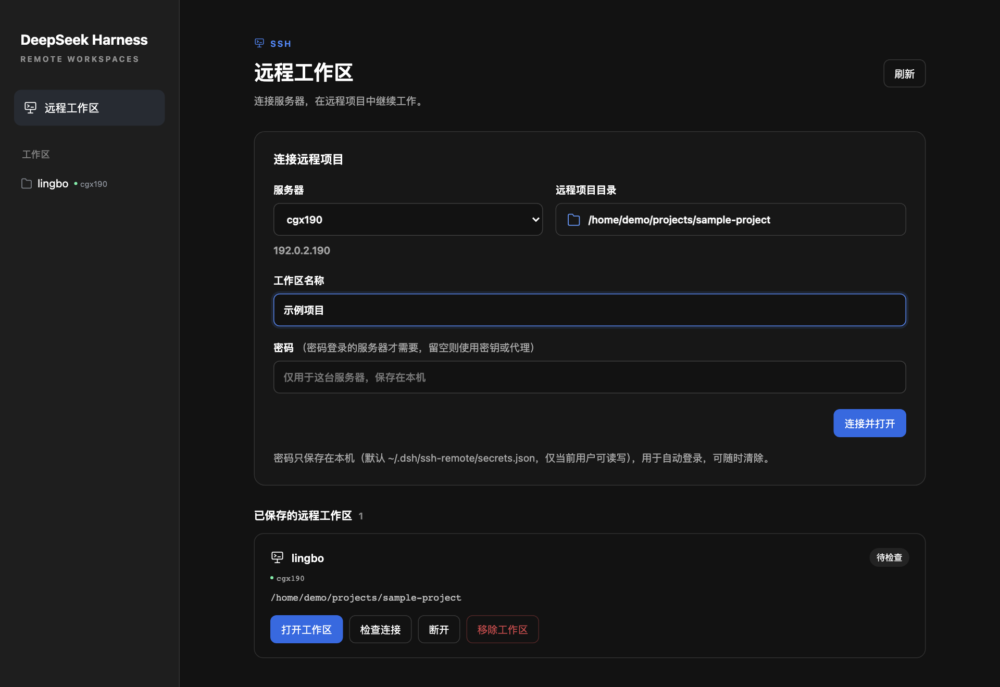
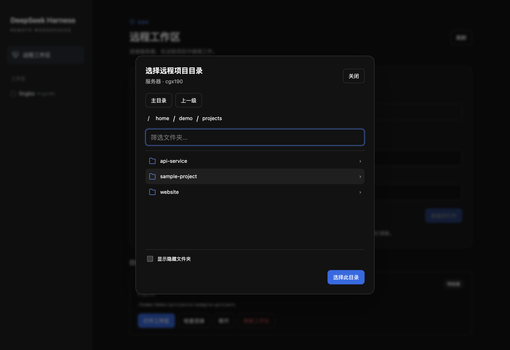

# DeepSeek Harness · Remote SSH

在 DeepSeek Harness 桌面侧边栏中连接 SSH 服务器，**浏览并选择远程目录**，直接打开远程工作区。



## 远程分区与侧栏分离

左侧栏中，「远程工作区」是与「工作区」并列的独立分区，按 **服务器 → 工作区 → 对话** 三层组织，直接用工作区名作为目录节点：

- **分区**：按服务器 → 工作区 → 会话组织，与本地工作区共用侧边栏滚动，不再固定高度或嵌套滚动；分区和目录的折叠状态会保留。
- **统一样式**：沿用原生 Workspaces 的字号、32px 行高、图标与按钮尺寸；服务器和目录名称不再额外加粗，时间使用紧凑格式。
- **工作区**：点击目录仅展开或收起会话，不打开编辑器。悬浮时显示原生「更多」、连接和新建会话图标，操作菜单平铺展示，不加分隔线。
- **会话**：点击会话才打开对应记录。当前尚未发送消息的会话显示为「新会话」，已归档会话不显示在侧栏。
- **原生菜单**：会话支持原生重命名、置顶、分叉和归档。删除会话需确认，确认后先归档再从远程列表移除，保留 Harness 历史日志及远程文件。
- **稳定位置**：打开会话不会改变服务器和工作区的排列；切换时保留侧边栏滚动位置。
- 远程工作区不会重复显示在原生 Workspaces 列表中；工作区选择器仍可选择远程目录。

分区标题右侧的设置与添加图标可打开完整管理页，连接服务器、选择目录、检查连接、管理密码或移除工作区。

## 目录选择

选择服务器 → 点击「选择服务器上的文件夹…」→ 打开目标文件夹 →「选择此目录」→「连接并打开」。

连接时可填写「工作区名称」，留空默认使用远程目录名。绿点标识远程工作区。



## 环境要求

本地支持 macOS、Linux 和 Windows。

- **macOS / Linux**：需要系统 OpenSSH。
- **Windows**：需要 OpenSSH 客户端（Windows 10/11 内置的「OpenSSH 客户端」可选功能即可，或 Git for Windows 自带的 `ssh`）与 PowerShell（系统自带，仅密码认证的 askpass 助手使用）。Windows 版 OpenSSH 不支持 ControlMaster 连接复用，插件在 Windows 上默认禁用多路复用（每次操作独立建连；可用配置项 `multiplex: true` 配合支持复用的 `ssh` 重新开启）。

远端需要 POSIX `sh`、GNU/BSD `stat`、`readlink`、`mktemp` 等常见命令；执行远程终端命令还需要 `bash`。

先在终端确认可以登录服务器（需要密码的服务器也可以，见下文「密码认证」）。示例 `~/.ssh/config`：

```sshconfig
Host dev-server
  HostName dev.example.com
  User demo
  IdentityFile ~/.ssh/id_ed25519
```

```sh
ssh dev-server
```

上面的服务器地址是示例，请替换为自己的配置。

## 密码认证

需要密码的服务器可以直接连接：在面板的「密码」里填一次，密码保存在本机，之后自动登录，不必每次输入。选择远程目录时也会带上这个密码；如果还没填，目录选择器里会内联提示输入一次，保存后重试即可。

- 密码保存在 `~/.dsh/ssh-remote/secrets.json`（0600，仅当前用户可读写），可用配置项 `secretsFile` 改路径；在面板中点「清除密码」即可删除。
- 认证走 OpenSSH 自己的 `SSH_ASKPASS` 机制：密码不会出现在命令行参数里，`ssh` 仍然自己完成认证。密码只在建立连接时用到，之后所有操作复用同一条多路复用连接（Windows 上无复用，见上文），连接过期后也会用保存的密码自动重建。
- 需要 OpenSSH ≥ 8.4（依赖 `SSH_ASKPASS_REQUIRE=force`，否则从终端启动 Harness 时 `ssh` 会去读 `/dev/tty`）。Windows 10/11 内置的 OpenSSH（8.6+/9.5）满足要求；askpass 助手是一个临时 `.cmd` 批处理，经 PowerShell 原样回显保存的密码。
- 只有当服务器提供 `password` 或 `keyboard-interactive` 认证时才会要求密码；纯密钥服务器仍按原来的方式处理。
- 不支持需要多轮交互的二次验证（例如两次 keyboard-interactive 提示），因为 askpass 每次只回答同一个密码。
- 密码文件是本机凭据：不要提交到仓库或分享给他人，同机同用户下的其他进程理论上可以读取它。
- 已保存密码的远程工作区行提供「修改密码」，密码变化后可直接输入新密码并重试连接；密码按服务器别名统一更新。

## 远程文件系统行为

远程工作区复用 Harness 的 `ctx.fs` / `ctx.shell` 后端，大部分行为与本地一致，以下几点刻意不同：

- **路径解析不解析符号链接**：`resolve` 只做路径归一化，不发远程请求，所以指向同一文件的符号链接别名会得到不同的目标身份。读写本身仍然跟随链接。
- **写入跟随最终符号链接**：与本地后端一致，写文件时更新链接指向的文件并保留链接；解析后的真实路径如果落到工作区之外（例如工作区内有指向 `/etc` 的链接），写入会被拒绝。
- **写围栏是词法围栏**：`confineMutations`（默认开启）只允许写当前工作区目录及 `extraWritableRoots` 中的远程路径，它不是操作系统级沙箱；工作区内的 `bash` 命令本身不受该围栏限制。
- **本地占位目录必须是空目录**：`ssh_mount` 的 `local_path` 不能指向已有本地项目或已注册工作区，避免把本地会话静默改道到远程。
- **文件变更靠轮询**：SSH 没有文件系统事件流，`watch` 按 `watchIntervalMs`（默认 3 秒）轮询目标，会产生周期性 `ssh` 调用。
- **所有操作共用一条多路复用连接**，默认空闲 600 秒后回收；连接过期后会自动重建（有保存密码时无需再次输入）。

## 安装

### 从 GitHub 安装（推荐）

先启动一次 Harness，使 `desktop` 配置目录存在，然后**完全退出 Harness**。直接让 DSH 从 GitHub 安装插件：

```sh
dsh plugin --profile desktop add github:chenqaq123/dsh-remote-ssh
```

macOS 如果找不到 `dsh` 命令，可以使用应用内自带的 CLI：

```sh
"/Applications/DeepSeek Harness.app/Contents/Resources/runtime/cli/bin/dsh" \
  plugin --profile desktop add github:chenqaq123/dsh-remote-ssh
```

安装完成后重新打开 Harness，在「插件 → 已安装」中管理 `dsh-ssh-remote-workspace`。停用插件并重启后，本地文件系统和终端后端会恢复。

Windows 上如果找不到 `dsh` 命令，同样可以使用应用内自带的 CLI：

```powershell
& "$env:LOCALAPPDATA\Programs\DeepSeek Harness\resources\runtime\cli\bin\dsh.cmd" `
  plugin --profile desktop add github:chenqaq123/dsh-remote-ssh
```

### 从源码安装

如果需要从当前 checkout 安装，将插件克隆到希望长期保留的位置：

```sh
git clone https://github.com/chenqaq123/dsh-remote-ssh.git
cd dsh-remote-ssh
npm install --omit=dev --ignore-scripts
node scripts/profile.mjs install desktop
```

默认安装会先执行 `npm pack`，把 tarball 写入 `~/.dsh/plugin-packages/`，再让 DSH 通过 `file:` 依赖安装。因此安装完成后可以移动或删除源码目录。机器上没有独立 npm 时，安装器会自动改用 Harness 桌面应用自带的 pnpm 打包；Windows 上的 `npm`/`dsh.cmd` 调用已全部适配。需要实时调试源码时才使用链接模式：

```sh
node scripts/profile.mjs install desktop --link
```

链接模式会把当前 checkout 注册为 `link:` 依赖，调试期间必须保留源码目录。

macOS 与 Windows 安装器优先使用桌面应用自带的 CLI；其他环境会从 PATH 查找 `dsh`。可用 `DSH_CLI=/绝对路径/dsh`（Windows 指向 `dsh.cmd`）指定命令，`DSH_HOME` 指定 DSH 配置根目录。

> 包名说明：本插件曾以 `dsh-ssh-remote` 名称开发，因该 npm 名已被占用，自 0.7.0 起更名为 `dsh-ssh-remote-workspace`。安装器会自动识别并移除旧名称的源码安装，配置、密码与工作区数据不受影响。

### 迁移旧安装

使用过旧版 `scripts/install.sh` 或 `scripts/profile.mjs` 的用户，在当前源码目录安装依赖后，完全退出 Harness，再运行默认的打包安装命令即可：

```sh
npm install --omit=dev --ignore-scripts
node scripts/profile.mjs install desktop
```

安装器会识别旧的配置区块（包括早期缩进的结束标记），将 SSH 自定义配置迁为原生插件的配置覆盖，并删除旧的加载入口及插件链接，避免重复加载。原先永久关闭本地后端的设置会移交给插件包，随插件启停。现有 SSH 配置、密码、挂载、工作区与会话数据均保留。

每次操作前，配置文件备份写入当前配置目录的 `.ssh-remote-backups/<时间戳>/`，目录仅当前用户可访问；原生命令失败时会恢复配置文件。发现不完整、重复或未知的旧加载区块时，安装器会停止而不修改配置。

### 更新与卸载

从 GitHub 安装的用户重新执行上面的 `dsh plugin ... add github:...` 命令即可更新。源码安装的用户完全退出 Harness 后，在当前源码目录重新运行 `node scripts/profile.mjs install desktop`；重新安装会保留已存在的原生停用状态。

通过 DSH 卸载：

```sh
dsh plugin --profile desktop remove dsh-ssh-remote-workspace
```

源码安装也可以运行：

```sh
node scripts/profile.mjs uninstall desktop
```

卸载只移除插件依赖与启用记录，保留 SSH 配置覆盖、密码、挂载、工作区和服务器文件。

## 移除远程工作区

「移除工作区」会归档相关会话并移除分组和远程映射，保留历史记录及服务器文件。有任务运行时，请先结束任务。

## 许可证

[MIT](LICENSE)。社区插件，与 DeepSeek 官方无隶属关系。
